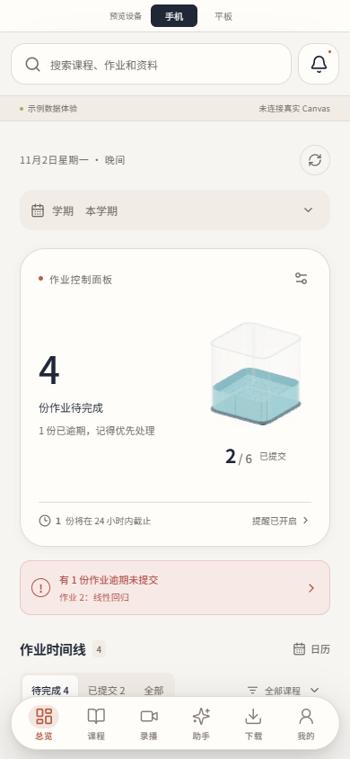
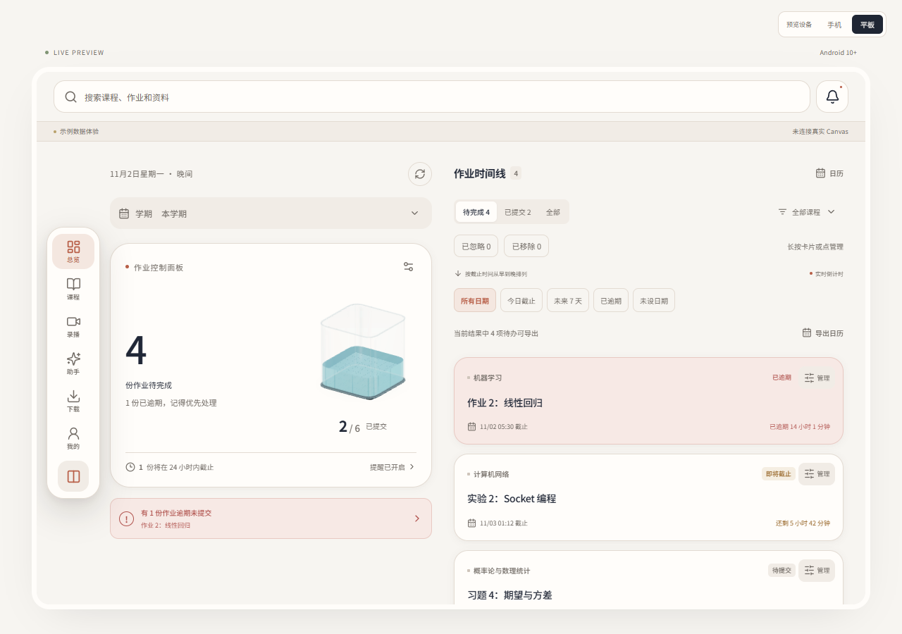
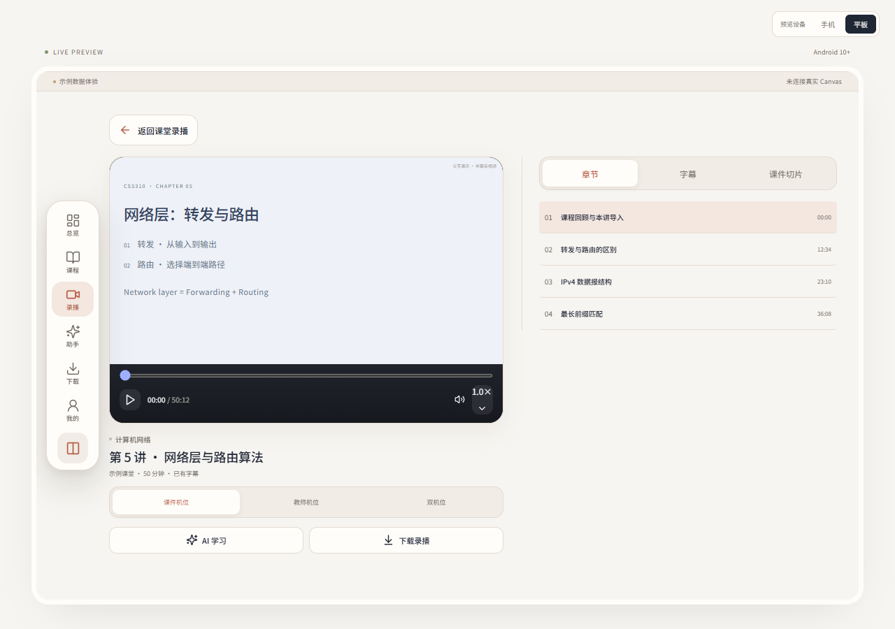
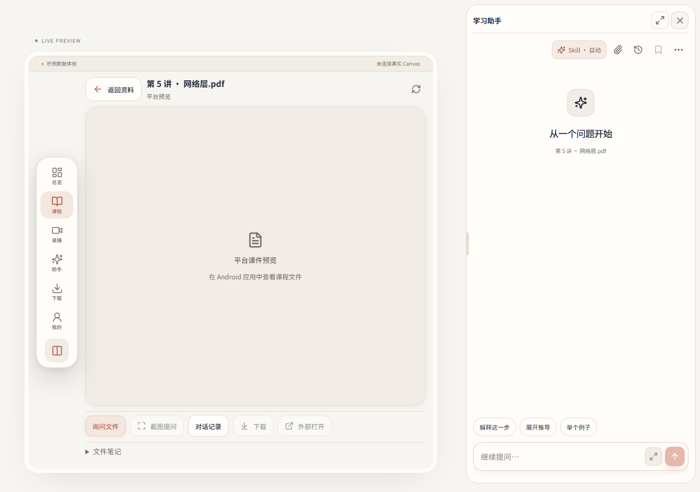

<div align="center">
  
  <h1>Canvas 随行</h1>
  <p>课程、作业、课堂资料与 AI 学习</p>
  <p>面向上海交通大学本部的 Android 学习助手 · 手机与平板</p>
  <p><strong>0.8.13 最新版 · Android 10+ · ARM64 · MIT</strong></p>
</div>

Canvas 随行将作业截止日期、课程资料、课堂录播和 AI 问答放在同一个学习空间。基于 [SJTU-Canvas-Helper](https://github.com/Okabe-Rintarou-0/SJTU-Canvas-Helper) 3.0.13 移植，采用 Tauri 2、React、Rust 与 Kotlin。非学校官方客户端，仅支持本部 `oc.sjtu.edu.cn`。

这是由 [Runhz](https://github.com/Runhz) 独立维护的 **Android 手机／平板移植 fork**，与上游作者无隶属关系。Windows／桌面版请使用[原项目](https://github.com/Okabe-Rintarou-0/SJTU-Canvas-Helper)；安卓问题请在[本 fork](https://github.com/Runhz/SJTU-Canvas-Helper-Android/issues)反馈。安卓开发与版本号在 `android` 分支独立演进，保留上游版权、MIT 许可及源码历史。

**最新版本：0.8.13（GitHub Latest）。** [下载 APK](https://github.com/Runhz/SJTU-Canvas-Helper-Android/releases/tag/android-v0.8.13)，本轮变更、已知限制与签名说明见 [版本说明](https://github.com/Runhz/SJTU-Canvas-Helper-Android/releases/tag/android-v0.8.13)。真实设备及学校服务验收仍在持续；此前版本 [0.5.4](https://github.com/Runhz/SJTU-Canvas-Helper-Android/releases/tag/android-v0.5.4) 仍保留。

## 看看界面

| 手机 · 学习总览 | 平板 · 学习总览 |
| --- | --- |
|  |  |

| 平板 · 课堂录播 | 平板 · 文件与 AI |
| --- | --- |
|  |  |

截图为 0.8.13 浏览器演示的示例数据，不代表真实 Canvas 内容；文件与 AI 图为演示占位课件，真机左侧为 Canvas 平台预览。支持日间、夜间和跟随系统；手机使用底部导航与 AI 弹窗，平板使用左侧悬浮导航、专注阅读及文件与 AI 两栏工作区。过渡动画遵从系统“减少动态效果”偏好。

## 能做什么

- **玻璃水池**：作业完成比例对应水量，连续 GPU 水面与透明玻璃立方体，支持触摸、倾斜及各轴摇晃；回到主页先展示最近真实渲染帧。属于高度场与立体光学表现，设备性能与传感器体验仍需实测。
- **近期日程**：展示 Canvas 返回的未来七天事件，可开启提前提醒，支持本机自定义日程；学校上课安排是否可见取决于平台数据。

- **作业控制面板**：截止时间排序、提交状态、要求及附件预览下载、提交入口、筛选与搜索、忽略与撤销、日历快照导出；提交成功后播放短暂庆祝动画。
- **课程资料**：账号隔离的目录缓存与按需刷新、课程置顶、文件搜索、后台下载与删除，以及外部打开、分享和导出。文件预览统一使用 Canvas 平台服务，支持内嵌小框和独立阅读页，不内置 Office 排版引擎。平板打开文件后进入专注阅读，自动隐藏课程头图和标签栏；询问文件、截图提问或查看对话时会切换为左侧文件、右侧 AI 两栏，手机仍保持 AI 弹窗。
- **课堂学习**：圆角内嵌／全屏播放器、倍速和长按加速、机位切换、字幕跟随与开关、课件切片小窗、视频与课件主次互换、截图标记与提问。全屏控件可自动收起并支持锁屏防误触；AI 与字幕选择保持弹窗，打开时隐藏并暂停原生视频。
- **继续学习**：切换页面保留课程、课堂、筛选与滚动位置；视频切走暂停，返回停在原处，重开应用可恢复进度与播放偏好。
- **AI 助手**：跨课程查询与按需读课件，提示词预设、追问建议、选中文字追问、截图及字幕时间上下文、对话提炼为笔记与回答提醒；支持流式回答、Markdown 与 LaTeX。Skill 按钮可选择、预览 14 种学习方式，包括解释当前、发明家视角、总结本堂、检查理解、交互图解与自由提问，默认自动选择；结合当前位置与整堂已加载字幕背景，按容量选取相关内容。课件正文及页面资料随对话保存，重新进入可以复用。PDF 页面可按需作为图片提供给视觉模型，不使用 OCR。服务返回的思考文本独立显示、默认折叠。使用自行配置的模型服务，不包含 ChatGPT 网页浏览器。
- **对话记录**：课堂和助手页可找回、搜索并继续本机历史；自动保存草稿和已收到的回答，可新建或确认删除对话，按账号与学校用户身份隔离。
- **笔记与搜索**：时间轴笔记、文件笔记和 AI 摘要保存在本机；支持搜索已缓存的文件正文、字幕与笔记。未准备的正文不会自动建立全文索引。
- **手机与平板**：根据可用宽高调整布局；支持单栏和双栏，选中一栏后通过导航切换该栏，另一栏保持原页面。手机竖屏回到单栏，平板使用左侧悬浮圆角导航，减少固定侧栏对内容的占用。
- **账号与提醒**：本部 Token、官方登录与二维码入口、本机加密保存；登录成功后立即写入加密存储，重启时并行校验，网络不可用时先回到离线缓存。未提交作业提醒基于最近同步结果安排。

学校服务与系统权限会影响可用性；双机位取决于设备解码能力。PDF 图像阅读要求模型支持视觉，默认只提供少量页面，未提供的页码会明确标注；可在问题中指定“第 9 页”按需读取。其他格式的内嵌图片需通过课件切片或截图提供，不内置 OCR 模型。

不包含成绩、讨论、人员名单、助教操作、PDF 生成／合并、Office 转换、视频合成和 MCP。云盘完整上传界面、多套命名模型配置及公开更新源尚未提供。

## 先体验

```sh
npm ci --prefix demo
npm --prefix demo run dev
```

需要 Node 24。打开终端显示的本地地址，即可体验手机／平板原型。**网页预览是示例数据，不需要填写真实凭据。** APK 才包含学校服务连接和原生能力。

安装包见 [GitHub Releases](https://github.com/Runhz/SJTU-Canvas-Helper-Android/releases)。0.8.13 使用本地构建的开发签名 APK，与 0.8.12／0.8.10 使用同一张证书；同包名、同签名时，较高版本可直接覆盖安装较低版本。开发签名不等同于正式发行签名。也可手动运行 **Build Android preview APK** 获取独立开发构建；不同环境的签名可能无法覆盖安装。Android 10 以下不支持。

## 开发与贡献

```sh
npm --prefix demo test
npm --prefix demo run build
npm --prefix demo run test:encoding
node tools/check-public-source.mjs
```

| 目录 | 职责 |
| --- | --- |
| `demo/src` | Android 响应式界面与浏览器演示，含前端测试 |
| `src-tauri/src/mobile*.rs` | 本部课程、文件、提交与 AI 的移动端接口 |
| `src-tauri/gen/android` | Kotlin 登录、系统文件与下载、播放器、提醒 |
| `tools/ai-core-tests` | 直接引用生产解析器、上下文及流式传输的 Rust 测试 |
| `docs/upstream` | 原桌面版说明和归档工作流 |

Android 构建详见 [构建指南](docs/BUILDING.md)，参与修改请读 [贡献指南](CONTRIBUTING.md)。

用户资料留在本机和相应服务之间；使用 AI 会将所选资料文字与图像发送给你配置的模型服务。参见 [隐私说明](PRIVACY.md)。请勿在 Issue 中提供 Token、Cookie、模型 Key 或私人课程内容，安全问题见 [SECURITY.md](SECURITY.md)。

## 路线与发布

下一步重点是完成真实设备／学校服务验收、补齐云盘上传与多模型配置、验证公开签名升级。进度见 [验收表](docs/ACCEPTANCE.md)，历史版本变化见 [CHANGELOG.md](CHANGELOG.md)，当前版本见 [GitHub Releases](https://github.com/Runhz/SJTU-Canvas-Helper-Android/releases)，开源导出与发布过程见 [发布说明](docs/RELEASING.md)。

感谢上游作者与贡献者。原版权及 MIT 许可完整保留于 [LICENSE](LICENSE)，基线与第三方许可边界见 [UPSTREAM.md](UPSTREAM.md)。
