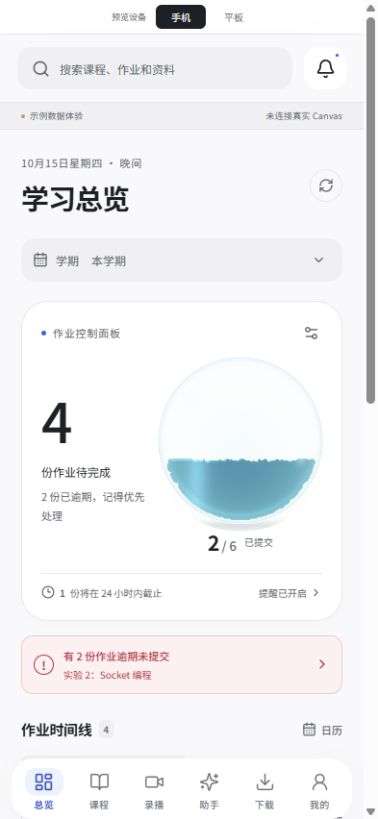
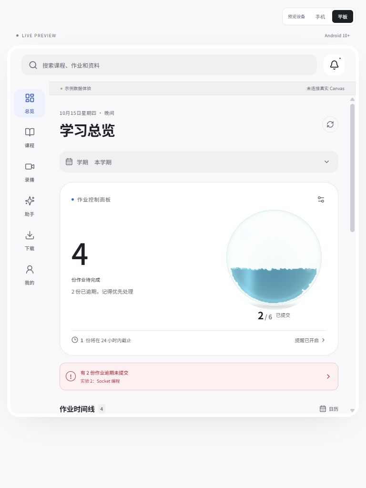

<div align="center">
  
  <h1>Canvas 随行</h1>
  <p>课程、作业与课堂资料</p>
  <p>面向上海交通大学本部的 Android 学习助手 · 手机与平板</p>
  <p><strong>0.5.4 · Android 10+ · ARM64 · MIT</strong></p>
</div>

Canvas 随行将作业截止日期、课程资料、课堂录播和 AI 问答放在同一个学习空间。基于 [SJTU-Canvas-Helper](https://github.com/Okabe-Rintarou-0/SJTU-Canvas-Helper) 3.0.13 移植，采用 Tauri 2、React、Rust 与 Kotlin。非学校官方客户端，仅支持本部 `oc.sjtu.edu.cn`。

这是由 [hzr666ABC](https://github.com/hzr666ABC) 独立维护的 **Android 手机／平板移植 fork**，与上游作者无隶属关系。Windows／桌面版请使用[原项目](https://github.com/Okabe-Rintarou-0/SJTU-Canvas-Helper)；安卓问题请在[本 fork](https://github.com/hzr666ABC/SJTU-Canvas-Helper-Android/issues)反馈。安卓开发与版本号在 `android` 分支独立演进，保留上游版权、MIT 许可及源码历史。

**0.5.4 正式 Release。** 用户于 2026-10-16 确认真机验收完成。[下载 APK](https://github.com/hzr666ABC/SJTU-Canvas-Helper-Android/releases/tag/android-v0.5.4)。支持范围与验收记录见 [验收表](docs/ACCEPTANCE.md)；浏览器演示仍使用示例数据。

## 看看界面

| 手机 · 学习总览 | 平板 · 课程空间 |
| --- | --- |
|  |  |

截图为 0.5.2 示例数据界面。中性底色与蓝色强调，支持日间、夜间和跟随系统；手机底部导航，平板侧边导航与分栏。过渡动画遵从系统“减少动态效果”偏好。最新修复、对话历史截图与验证边界见 [0.5.4 记录](docs/RELEASE_0.5.4.md)。

## 能做什么

- **水缸效果**：作业完成比例对应水量，采用 FLIP 自由液面模拟，支持倒置、惯性流动、撞壁、液滴分离与回落。三档均为连续液体，按模拟精细度和帧率区分；透明玻璃使用 WebGL 2，不支持时使用同一模拟的 Canvas 渲染。默认高清，设置中可切换。
- **近期日程**：展示 Canvas 实际返回的未来七天事件，可开启提前提醒；是否包含上课安排取决于学校录入的数据。

- **作业控制面板**：截止时间排序、提交状态、倒计时、学期筛选、今日／七天／逾期筛选、搜索、忽略与撤销、日历快照导出。
- **课程资料**：账号隔离的目录缓存与按需刷新、课程置顶、文件搜索、后台下载，以及外部打开、分享和导出。
- **课堂学习**：圆角内嵌／全屏播放器、倍速和机位切换，字幕跟随与选择、字幕下载、课件切片、截图提问和课堂总结。
- **继续学习**：切换页面保留课程、课堂、筛选与滚动位置；视频切走暂停，返回停在原处，重开应用可恢复进度与播放偏好。
- **AI 助手**：跨课程查询与按需读课件，模型能力发现、自动上下文适配、流式回答、Markdown 与 LaTeX、PPT/PPTX 等文字提取。
- **对话记录**：课堂和助手页可找回、搜索并继续本机历史；自动保存草稿和已收到的回答，可新建或确认删除对话，按账号与学校用户身份隔离。
- **账号与提醒**：本部 Token、官方登录与二维码入口、本机加密保存，基于最近同步结果安排未提交作业提醒。

学校服务与系统权限会影响可用性；双机位取决于设备解码能力。图片型课件没有可提取文字时会明确提示，首版不内置 OCR 模型。

不包含成绩、讨论、人员名单、助教操作、文档内嵌预览、PDF 生成／合并、Office 转换、视频合成和 MCP。云盘完整上传界面、多套命名模型配置及公开更新源仍在计划中。

## 先体验

```sh
npm ci --prefix demo
npm --prefix demo run dev
```

需要 Node 24。打开终端显示的本地地址，即可体验手机／平板原型。**网页预览是示例数据，不需要填写真实凭据。** APK 才包含学校服务连接和原生能力。

安装包见 [GitHub Releases](https://github.com/hzr666ABC/SJTU-Canvas-Helper-Android/releases)。0.5.4 沿用此前开发证书，可覆盖同签名旧版。也可在本仓库 GitHub Actions 中手动运行 **Build Android preview APK** 获取独立开发构建。Android 10 以下不支持；不同构建环境的签名可能无法覆盖安装。

## 开发与贡献

```sh
npm --prefix demo test
npm --prefix demo run build
npm --prefix demo run test:encoding
node tools/check-public-source.mjs
```

| 目录 | 职责 |
| --- | --- |
| `demo/src` | Android 响应式界面与浏览器演示，含前端测试 |
| `src-tauri/src/mobile*.rs` | 本部课程、文件、提交与 AI 的移动端接口 |
| `src-tauri/gen/android` | Kotlin 登录、系统文件与下载、播放器、提醒 |
| `tools/ai-core-tests` | 直接引用生产解析器、上下文及流式传输的 Rust 测试 |
| `docs/upstream` | 原桌面版说明和归档工作流 |

Android 构建详见 [构建指南](docs/BUILDING.md)，参与修改请读 [贡献指南](CONTRIBUTING.md)。

用户资料留在本机和相应服务之间；使用 AI 会将所选资料文字发送给你配置的模型服务。参见 [隐私说明](PRIVACY.md)。请勿在 Issue 中提供 Token、Cookie、模型 Key 或私人课程内容，安全问题见 [SECURITY.md](SECURITY.md)。

## 路线与发布

下一步重点是完成真实设备／学校服务验收、补齐云盘上传与多模型配置、验证公开签名升级。进度见 [验收表](docs/ACCEPTANCE.md)，版本变化见 [CHANGELOG.md](CHANGELOG.md)，开源导出与发布过程见 [发布说明](docs/RELEASING.md)。

感谢上游作者与贡献者。原版权及 MIT 许可完整保留于 [LICENSE](LICENSE)，基线与第三方许可边界见 [UPSTREAM.md](UPSTREAM.md)。
