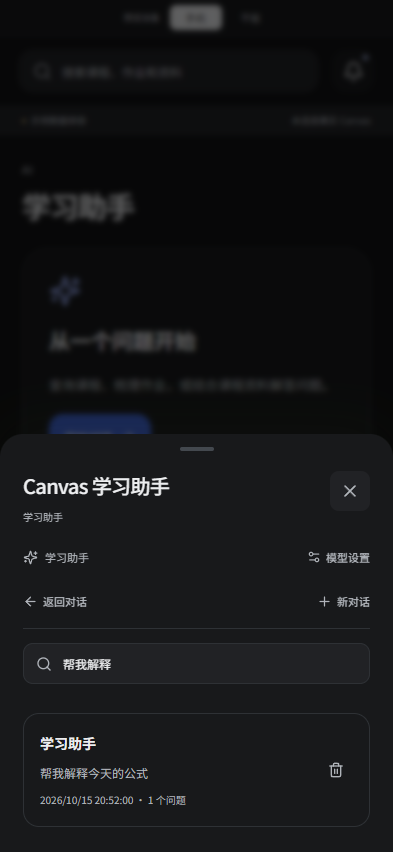
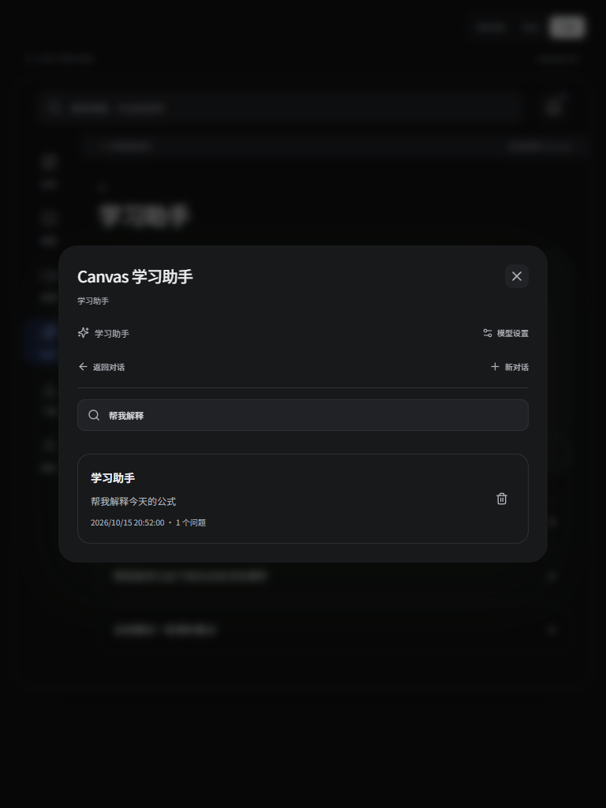

# 0.5.4 · 继续学习与对话历史

2026-10-15。Android 10+，ARM64，版本码 `5004`，包名 `com.canvas.sjtu.mobile`。沿用此前开发签名，支持尝试覆盖安装；仍为预览版。

## 页面与录播

- 主导航保留课程、课堂、资料页签、搜索和筛选；恢复各页面滚动位置，重开应用可回到上次页面。
- 切走录播页面时隐藏并暂停原生视频，返回复用同一播放器与位置，不重新拉播放地址；隐藏后的延迟请求不会自动播放。
- 进度每五秒及暂停时保存，倍速、机位及双机位偏好一同保存；重开应用恢复到暂停画面。
- 账号／学校用户身份切换时重建界面，分别读取各自的页面和对话记录。首页水缸的动态状态不保存。

## AI 对话

- 自动保存消息、草稿、选用的字幕／OCR 上下文和截图，文件来源只保存 ID，读取时使用当前鉴权。
- 意外关闭弹窗不销毁对话，回答继续接收；正常页面退出时立即保存已收到的正文，流式输出期间定期落盘。进程被系统突然终止时以最近一次保存为准。
- 课堂页“本堂课的对话记录”查看当前课堂；助手页“历史对话”查找全部记录。支持按课堂或问题搜索、继续、新对话及确认删除。
- 数据存放于本机 IndexedDB。保存失败显示提示；普通缓存清理不删除历史。不同账号及同名但不同学校用户的记录隔离。
- 完整历史保留在本机；发给模型的历史按其上下文容量选用，移除固定 12／14 条消息限制。

## 验证与边界

- 前端 27 个测试文件、95 项测试通过，包含实际主应用原生桥模拟的切页复用与重建恢复、同名账号身份隔离、草稿恢复、关闭期间流式接收、半段正文退出保存、历史查询／删除、长历史传输。
- 类型检查、生产构建、严格 UTF-8 和中文配置往返检查通过。
- 手机 393×852、Pad 768×1024 浏览器检查通过，无横向溢出。使用真实 IndexedDB 走通提问中关闭、重新打开、页面重载、从历史恢复及草稿回填；模型回答为演示数据。
- ARM64 Rust、Kotlin 与 Gradle 构建成功；APK 签名、包名、版本码、架构、当前前端资源标识及打包原生库哈希核对通过。
- 本轮无连接的安卓设备；实际机型的长时间播放、进程重建、系统回收、账号切换与覆盖升级保留真机待验，不将浏览器或桥模拟测试写成真机通过。

## 安装包

- `artifacts/Canvas-Suixing-latest.apk`，`107320590` 字节。
- SHA-256：`e077e018efa3059429bd1e8c2771689d0c608c789df3595fc587a24d85f7ccfc`。
- 证书 SHA-256：`9537c7811c55d47a4a815f1fff65d0ef050fcdf1287013a371070beafa53b594`。
- 最低 SDK 29，目标 SDK 36；不需要先卸载旧版。

| 手机历史对话 | Pad 历史对话 |
| --- | --- |
|  |  |

截图仅含示例数据。来源、许可与上游 Windows／桌面版关系保持不变，详见 [UPSTREAM.md](../UPSTREAM.md)。
