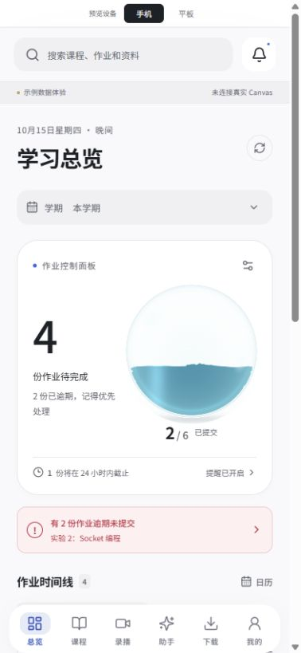
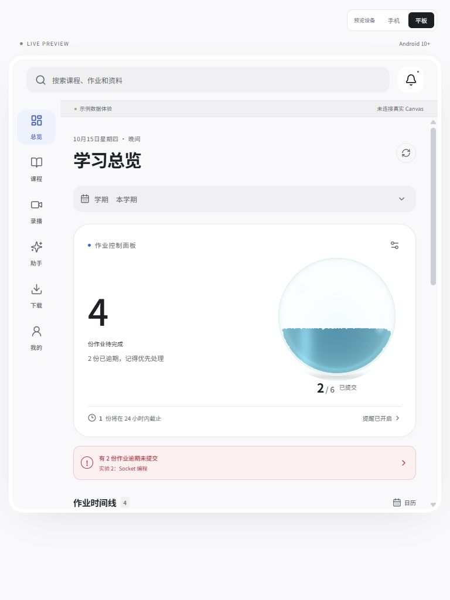
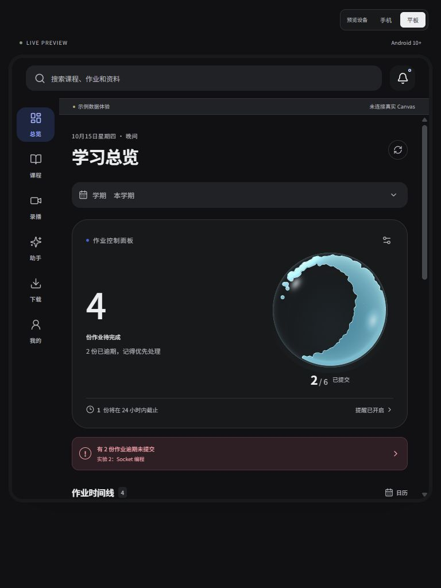

# 水缸流体重做记录

日期：2026-10-15。用户已确认连续水面，现随 [0.5.2](RELEASE_0.5.2.md) 整合到主应用与最新 ARM64 APK。以下保留水面移植、修复和未打包阶段的检查记录。

## 粒子孔洞修复

用户演示中出现密集孔洞和粒子白边，旧的逐点密度及高光渲染不符合连续水面的要求。当前改用 `LiquidSurface.ts`：质量沉积、按物理尺度平滑、完整轮廓、内部孔洞填充、水量面积约束，以及轮廓距离场。WebGL 和 Canvas 使用同一重建结果，不再从粒子密度计算内部反光。

高光只依赖整体曲面和外轮廓。滤掉微小碎片并限制小液滴数量；距离场平滑保留轮廓的连通性，避免平滑后再次出现小孔。三档轮廓分辨率分别为 64／96／128，不依赖 GPU 点精灵尺寸。Demo 手机预览缩小水缸区域，便于同时看到水体和摇晃按钮。

本次 20 个测试文件、76 项测试通过。新增渲染重建回归覆盖：人为删去部分粒子后的内孔、三档满水、连续强冲击后的透明孔洞与水量面积误差，以及空缸。强冲击测试同时检查材质透明度三个阈值，避免只验证模拟粒子而忽略实际水面。渲染重建的桌面样本中，40% 水量的面积绝对误差在 0.7 个百分点内；仍不代表真机性能。

以下为前次 FLIP 移植记录，其中 72 项测试与旧密度场描述属于修复前状态；以本节为准。此修复阶段未构建 APK，最终打包与检查结果见 0.5.2 记录。

修复后预览：[40% 水量](screenshots/water-continuous-demo.jpg)、[满水](screenshots/water-continuous-full.jpg)。

## 实现

- 将旋转裁剪球体与正弦波改为 FLIP 自由液面求解。粒子与网格交换速度、求解不可压缩压力，并与固定圆形边界碰撞。
- 重力方向及线性加速度直接作用于流体。撞壁产生沿壁流动，足够强的扰动可以分离液滴，随后回落。
- 用粒子密度场重建连续液体，分离的水滴保持独立；增加玻璃反射、液体厚度着色、边缘反光。三档都取消像素风。
- 模拟固定为 120 次小步／秒，渲染目标分别为 30／45／60 帧；分辨率、压力求解次数、像素比例随档位变化。离屏及后台沿用暂停机制。
- 作业数变化时仅增减所需水量，不重置已有粒子的运动。图形不支持时使用同一模拟的 Canvas 渲染，省电选择仍生效。

这是二维自由液面模拟与立体光学表现。前后方向的冲击被投影为扰动，并非完整三维流体。

## 来源及许可

- [mobile-fluid-sim](https://github.com/shajidhasan/mobile-fluid-sim)，固定提交 `52eca767d1d81b166ed8a930a8ffd67b7d14fb73`，MIT。求解器保留在 `demo/src/fluid/FlipFluid.ts`；圆形边界与传感器改造位于 `TankFluid.ts`。
- 原算法参考 [Matthias Müller / Ten Minute Physics FLIP](https://matthias-research.github.io/pages/tenMinutePhysics/18-flip.html)，MIT。
- 两份许可均保留在求解器目录及 `demo/public/licenses/`，构建时随应用资源分发。具体说明见根目录 `THIRD_PARTY_NOTICES.md`。

## 已完成验证

- 前端：19 个测试文件、72 项测试通过；类型检查及生产构建通过。构建仍有既有的大文件体积提示。
- 流体测试覆盖圆形边界、摇晃后不丢失粒子、空／满／部分水量、数值有限、静水恢复、倒置流动、自由水滴、30／45／60 显示帧率下时间步一致。
- 在强扰动样本中，液体超过原始水位形成浪头；检测到独立低邻居密度粒子，并验证回落后的平均位置及动能恢复。
- 393×852 手机及 768×1024 Pad 浏览器预览，无横向溢出；检查日间高清、夜间省电，两者均为 FLIP 渲染。强扰动可见沿壁浪头及独立液滴，浏览器未记录图形错误。
- UTF-8 检查通过：中文 JSON 往返、61 个前端源码文件、无 BOM、精确界面字符串。

桌面 Node 的纯求解器样本（40% 水量，预热后 240 帧，每帧模拟 1/60 秒）：

| 档位 | 粒子数 | 求解耗时／帧 |
| --- | ---: | ---: |
| 省电 | 582 | 0.48 ms |
| 均衡 | 969 | 0.95 ms |
| 高清 | 1463 | 1.60 ms |

此数据不包含图形渲染，不能代表手机帧率或耗电。原始记录在不导出的 `local-diagnostics/water-fluid-performance.json`。

## 预览证据

## 待真机确认

手机及 Pad 的实际传感器方向、手摇响应、长时间帧率与耗电，以及 WebGL 不可用设备的 Canvas 表现。浏览器点击扰动和数值测试不能替代这些验收。

水面探索阶段未构建 APK；最终已随 0.5.2 打包。未导出源码包，未创建压缩包，也未提交或发布仓库。
